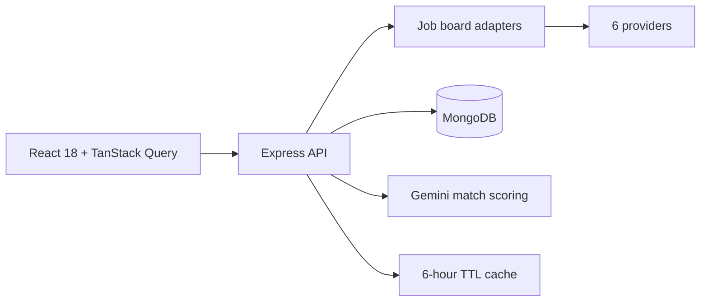

# Applied

An AI job search and application tracker that aggregates multiple job boards, scores matches, and keeps deadlines visible.

## Overview

Applied is a job-hunt command center built on the MERN stack. It searches six boards in parallel, removes duplicates, scores each role against the user's profile, and keeps the application pipeline organized.

- 24 REST APIs
- 6 job boards aggregated in parallel
- 6-hour TTL cache on repeat searches
- WCAG 2.1 AA dashboard

## Key Features

- Parallel job search with de-duplication
- AI match scoring
- Application status pipeline
- 14-day deadline ruler
- TanStack Query caching
- Accessible React 18 dashboard

## Architecture



## Tech Stack & Why

| Layer | Choice | Why |
| --- | --- | --- |
| UI | React 18 + Tailwind CSS | Fast, accessible dashboard |
| Data fetching | TanStack Query | Caching, retries, background refresh |
| Backend | Express | 24 REST endpoints |
| Database | MongoDB | Flexible application records |
| AI | Gemini | Match scoring |

## Backend Flow

1. Search request fans out to six job providers in parallel.
2. Results are normalized and de-duplicated.
3. Gemini scores matches against the user profile.
4. Responses are cached for 6 hours; repeat searches skip provider calls.
5. Applications and deadlines are stored in MongoDB.

**TODO:** Add the exact provider list, rate-limit strategy, and cache implementation.

## Database Schema

```text
users:        _id, name, email, profile
applications: _id, userId, company, role, status, appliedAt, deadline
searches:     _id, userId, query, cachedAt, results[]
```

**TODO:** Replace with the real schemas and indexes.

## Challenges & Solutions

- **Provider latency:** parallel requests and a 6-hour TTL cache keep repeat searches fast.
- **Duplicate listings:** normalized company/role keys remove duplicates before scoring.
- **Accessibility:** keyboard navigation, focus states, and contrast were built to WCAG 2.1 AA.

## Results

- 24 REST APIs
- 6 job boards in one search
- 6-hour cache window
- WCAG 2.1 AA dashboard

## Links

- [Live demo](https://applied-tracker.vercel.app/)
- [GitHub repository](https://github.com/Brijesh667/Applied)
