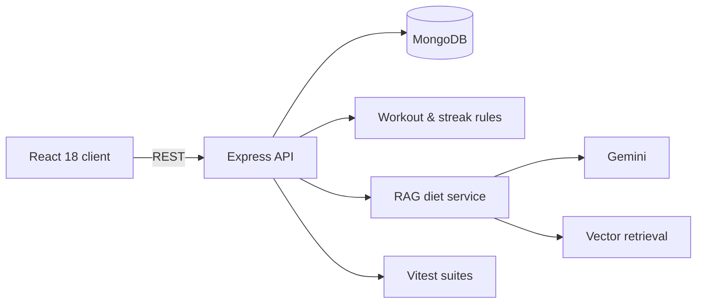

# MyFitness

A mobile-first fitness platform with workout tracking, progress analytics, and a RAG diet assistant.

## Overview

MyFitness combines a TypeScript + MERN workout tracker with an AI diet coach. The app is designed for the gym floor: fast logging, a plan you can follow, and progress you can see.

- 40 REST APIs
- 50+ exercises across 13 muscle groups
- 120-day activity heatmap
- 14 backend test suites

## Key Features

- Weekly push/pull/legs planning and workout logging
- Exercise library covering 13 muscle groups
- Session timer and workout history
- 120-day activity heatmap
- Rule-based streak analytics
- RAG diet assistant with Zod-validated meal plans and source citations

## Architecture



## Tech Stack & Why

| Layer | Choice |
| --- | --- |
| Frontend | React 18 + TypeScript |
| Backend | Node.js + Express |
| Database | MongoDB |
| AI | Gemini + RAG |
| Validation | Zod |
| Tests | Vitest |

TypeScript keeps the API contracts and meal-plan shapes explicit; Zod validates AI output before it reaches the client.

## Backend Flow

1. Client fetches today's plan and recent sessions.
2. Workout logs are written through REST endpoints.
3. Streak and heatmap data are derived from session history.
4. The diet assistant retrieves context, asks Gemini for a plan, validates it with Zod, and returns citations.

**TODO:** Document auth, endpoint list, and caching.

## Database Schema

```text
users:     _id, name, email, goal, createdAt
workouts:  _id, userId, date, exercises[], duration
exercises: _id, name, muscleGroup, instructions
meals:     _id, userId, date, plan, sources[]
```

**TODO:** Replace with the real schemas and indexes.

## Challenges & Solutions

- **AI output reliability:** Zod validation rejects malformed meal plans before rendering.
- **Mobile-first UX:** large tap targets and a compact daily view keep logging fast in the gym.
- **Test coverage:** 14 backend suites cover streak rules, workout APIs, and diet validation.

## Results

- 40 APIs and 50+ exercises shipped
- 120-day progress heatmap
- 14 backend test suites
- Live on Vercel

## Links

- [Live demo](https://my-fitness-full-stack.vercel.app/)
- [GitHub repository](https://github.com/Brijesh667/My_Fitness_full_stack)
