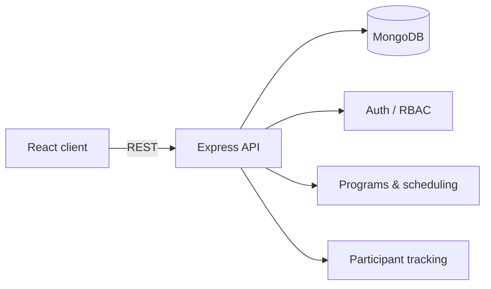

# Prashikshak

A centralized training management portal built for program administrators, trainers, and participants.

> **TODO:** Replace placeholder screenshots with product screenshots and add any real deployment details.

## Overview

Prashikshak replaces scattered spreadsheets and manual coordination with one training portal. It was built during Smart India Hackathon 2025 and won **1st place among 500+ teams**.

The system supports role-based access for administrators and participants, scheduling, participant tracking, and program-level reporting.

## Key Features

- Centralized training programs and schedules
- Role-based access control
- Participant enrolment and progress tracking
- Admin dashboards for scheduling and reporting
- REST API layer for the React client

**Result:** manual scheduling work reduced by **60%**.

## Architecture



**TODO:** Add the deployed URL, hosting details, and any queue/cache services.

## Tech Stack & Why

| Layer | Choice | Why |
| --- | --- | --- |
| Frontend | React | Component-driven admin and participant views |
| Backend | Node.js + Express | Fast REST APIs with a small, familiar stack |
| Database | MongoDB | Flexible program and participant records |
| Auth | Role-based access | Separate admin, trainer, and participant permissions |

## Backend Flow

1. User signs in and receives a session/JWT (TODO: confirm the auth mechanism used).
2. Role middleware guards admin-only routes.
3. Program and participant routes read/write MongoDB documents.
4. The React dashboard consumes the REST endpoints.

**TODO:** Document the exact routes, middleware, and status codes.

## Database Schema

**TODO:** Add the real collections and fields. A likely starting point:

```text
users:      _id, name, email, passwordHash, role
programs:   _id, title, description, startDate, endDate, trainerId
sessions:   _id, programId, title, scheduledAt, duration
enrolments: _id, programId, userId, status, progress
```

## Challenges & Solutions

- **Coordination across roles:** a single role model was needed so admins and participants saw different views. Solved with route-level access checks.
- **Scheduling overhead:** manual scheduling was the biggest time sink; program and session records reduced it by 60%.

**TODO:** Add the hardest technical problem you solved and how you measured the result.

## Results

- **1st place** at Smart India Hackathon 2025
- 500+ competing teams
- 60% reduction in manual scheduling work

## Links

- [GitHub repository](https://github.com/Brijesh667/Prashikshak)
- Live demo: TODO
