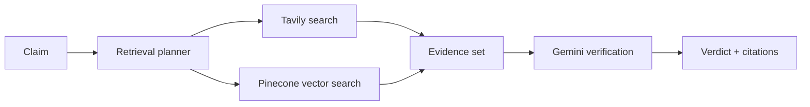

# Sentinels of Truth

An AI fact-verification engine that checks a claim against live sources and returns a grounded verdict.

> **TODO:** Confirm the reported 99.00% accuracy. The resume says 99.00%; another note says 94/100. Update `src/data/projects.js` once confirmed.

## Overview

Sentinels of Truth accepts a claim, retrieves evidence, and produces a verdict with sources. The pipeline is built for speed and traceability rather than a single opaque model response.

- Average latency: **11.78 seconds per claim**
- Coverage: **6+ knowledge domains**
- Evaluation set: **100 diverse factual claims**
- Pipeline errors: **0**

## Key Features

- Claim input and verification flow
- Tavily-powered retrieval over live web sources
- Gemini-based reasoning and verdict generation
- Pinecone vector retrieval for grounding
- Source citations alongside the verdict
- Latency and accuracy benchmark harness

## Architecture



**TODO:** Replace this with the exact architecture and deployment topology.

## Tech Stack & Why

| Technology | Role |
| --- | --- |
| Tavily API | Fresh web retrieval for claims |
| Gemini (3.8 Flash Lite) | Reasoning and verdict generation |
| Pinecone | Vector storage and semantic retrieval |
| Next.js / React | User interface (TODO: confirm frontend) |

## Backend Flow

1. Accept a claim from the client.
2. Run a retrieval plan across web search and the vector index.
3. Normalize and deduplicate evidence.
4. Ask the model to verify the claim against the evidence.
5. Return a verdict, confidence, and source list.

**TODO:** Add API route names, request/response shape, and timeout/retry strategy.

## Database Schema

**TODO:** Add the vector index configuration and any claim history schema.

```text
claims:   _id, text, verdict, confidence, sources[], createdAt
sources:  url, title, snippet, retrievedAt
```

## Challenges & Solutions

- **Latency:** parallel retrieval keeps the average near 11.78 s per claim.
- **Grounding:** every verdict includes retrieved evidence so users can inspect the source.
- **Reliability:** the benchmark run completed with zero pipeline errors.

**TODO:** Document rate-limit handling and model fallbacks.

## Results

- 11.78 s average latency across 6+ domains
- 100 claims evaluated
- Reported accuracy: 99.00% (TODO: confirm)
- 0 pipeline errors

## Links

- [Live demo](https://sentinels-of-truth-93j9.vercel.app/)
- [GitHub repository](https://github.com/Brijesh667/Sentinels_of_Truth)
